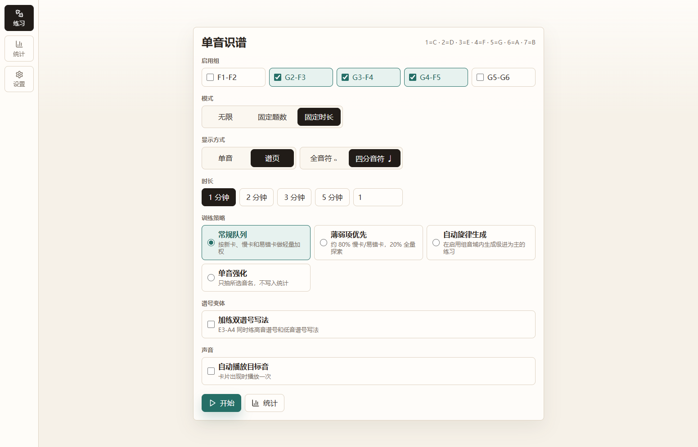
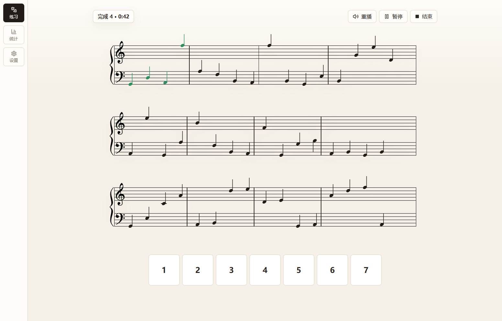
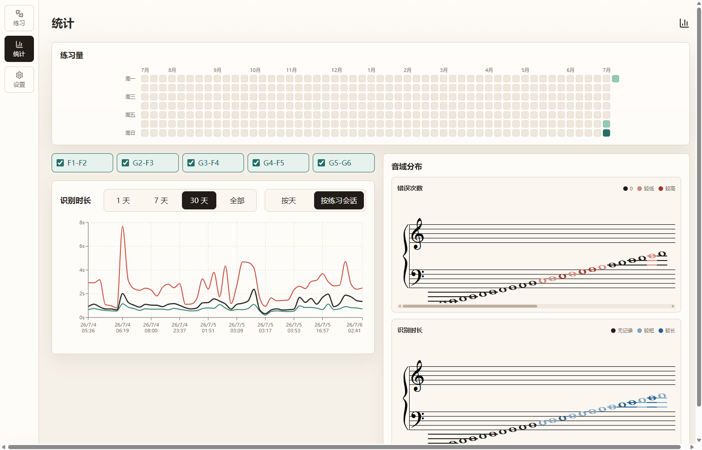

# 单音识谱

一个在浏览器中练习钢琴识谱、听音与音准的工具。从音名和谱位的对应关系入手，逐步练习连续读谱，也可以录下清唱，回听并观察音高变化。练习历史和音频素材保存在本地，便于持续练习和回顾。

## 使用

直接打开 https://coolermzb3.github.io/anki-note/ 

MIDI、麦克风和目录备份需要浏览器支持相应接口，并在首次使用时授权。

### 识谱与听音

不熟悉谱位时，可以先在「学习」页查看音名与五线谱的对应关系、点击发声，再用默写重建各音名的谱位。听音自测可用 `0` 键播放音符，再按键作答；默写完成后可以比较历次用时。

在「练习」页选择音区和高音、低音或大谱表，从单音辨认开始，也可以切换到整页谱面连续读谱。默认的自适应队列会安排出题；想集中练某几个音名时选「单音强化」，想练习有旋律联系的音符时选「旋律生成」。练习可以持续进行，也可以按题数或时长结束。

作答可使用电脑数字键、屏幕琴键或 MIDI 键盘。「统计」页用识谱速度趋势、练习热力图和答对进度展示积累，并在条件可比的练习之间比较表现。

<details name="screenshots" open>
<summary>练习设置</summary>



</details>

<details name="screenshots">
<summary>练习中</summary>



</details>

<details name="screenshots">
<summary>统计</summary>



</details>

### MIDI 键盘

首次使用时在“设置 → MIDI 键盘”中授权并选择输入设备。浏览器已有 MIDI 权限时，后续打开页面会静默尝试恢复连接；未授权或自动连接失败时仍可手动连接。连接后可在练习前选择：

- `只认音名`：电脑数字键、屏幕琴键和 MIDI 可同时作答，MIDI 不限八度；
- `精确音高`：只接受 MIDI 输入，音名与八度都必须和谱面一致。设备断开时练习会自动暂停。

连接后还可在练习设置页或结果页按 C4 开始。设备测试、按键生命周期和历史分组规则见 [MIDI 输入说明](docs/midi-input.md)。

### 清唱与音高回看

在「清唱」页用麦克风录音或导入单声部人声文件，沿时间查看音高轨迹、音名和音分偏差，再配合回放检查长音、滑音或音准变化。音频在浏览器中分析；首次使用增强分析时会提示下载模型，之后缓存复用。

录音和导入的文件可以保存为素材，之后继续回听或重新分析。这里提供音高观察，不对演唱打分，也不计入识谱练习统计。

### 数据与备份

练习、默写、设置和已保存的清唱素材默认保存在当前浏览器。建议在「设置 → 备份目录」中选择本地文件夹：学习记录会写入备份，音频另存为独立文件。

在线版和本地开发地址使用不同的浏览器存储；换地址或浏览器时，需要重新选择同一备份目录才能接续数据。两边都有不同修改时，应用会提示选择保留哪一侧的数据。未备份的数据可能随浏览器存储清理而丢失。

## 开发

前端使用 React、TypeScript 和 Vite，数据存储在 IndexedDB，无需应用后端。`analysis/` 是独立的 Python 离线分析工具，不参与前端运行。

### 本地启动与验证

本项目本地开发使用 Windows 的 Node.js 和 pnpm，版本分别见 [.node-version](.node-version) 和 [package.json](package.json)。本机可直接双击 [start.bat](start.bat)，脚本通过 `C:\Dev\autostart.bat` 初始化环境，首次安装依赖并打开 `http://127.0.0.1:6136/`。

手动启动时，在已初始化 Node.js 和 pnpm 的 Windows 终端中运行：

```powershell
pnpm install
pnpm run dev
```

首次配置开发环境时，用 uv 安装提交钩子：

```powershell
uv sync --project analysis
uv run --project analysis pre-commit install
```

日常验证运行 `pnpm test`。提交钩子会检查并格式化改动的 Python 文件，并执行前端生产构建；普通修改无需另外运行构建。从 WSL 编辑时，安装依赖和验证仍使用 Windows 工具链，具体约定见 [AGENTS.md](AGENTS.md)。

### 实现与分析文档

- [MIDI 输入与答题判定](docs/midi-input.md)
- [练习历史比较规则](docs/practice-comparison.md)
- [答对进度图规则](docs/session-progress.md)
- [自动旋律生成规则](docs/melody-generation.md)
- [清唱工作区与音高分析](docs/vocal-pitch-workspace.md)
- [离线练习队列分析](analysis/README.md)
- [UI 手调位置速查](docs/ui-tuning.md)

### 部署与临时预览

推送到 `main` 后，GitHub Actions 会运行测试、构建 `dist` 并部署到 GitHub Pages。

需要从其他设备临时访问当前工作区时，可使用 Tailscale 提供 HTTPS 预览。

Windows 本机已登录 Tailscale 后，可双击 `tailscale-preview-on.bat`。脚本开头询问是否启用公网访问：直接按 Enter 或输入非 `y` 值时使用 Tailscale Serve，仅 Tailnet 内可访问；输入 `y` 时使用 Tailscale Funnel，允许公网访问。公网模式要求当前 tailnet 已启用 Funnel。

脚本会构建当前工作区，在 `127.0.0.1:6137` 启动独立的 Vite 预览，并提供 HTTPS；它不会占用或停止 `6136` 开发服务器。开启成功后保留该窗口，测试完成时直接按 Enter 即可关闭 Tailscale 入口和 `6137` 预览。

Funnel 地址没有应用级密码。如果误关了开启脚本的窗口，必须双击 `tailscale-preview-off.bat` 补做清理。关闭操作会先撤销 Serve 或 Funnel 入口，再停止脚本启动的 `6137` 预览；若该端口被无关进程占用，脚本会拒绝停止或覆盖该进程。
